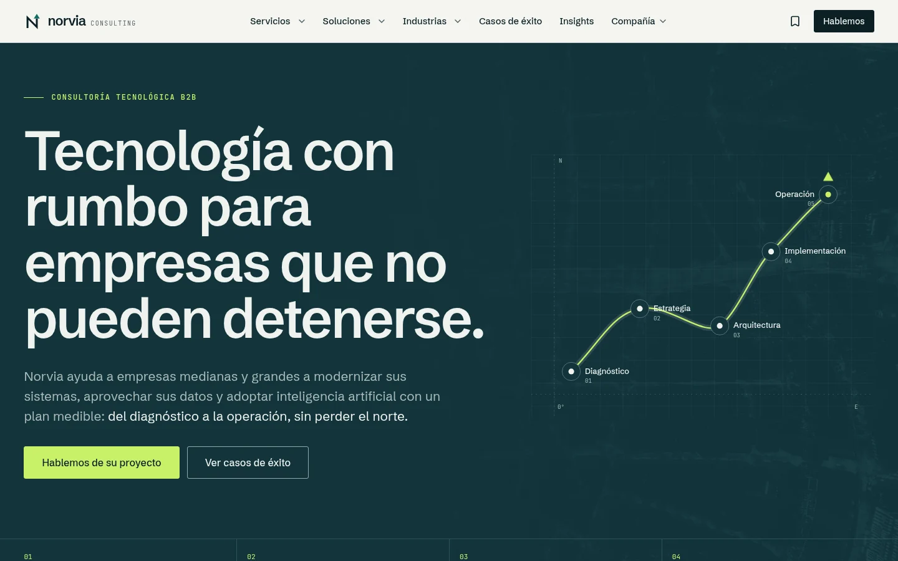

# Norvia Consulting

**Tecnología con rumbo.** Sitio web corporativo multipágina de **Norvia**, una consultora tecnológica B2B **ficticia**, desarrollado como proyecto de portafolio de desarrollo frontend.

- **Sitio:** https://norvia.kaled.dev
- **Repositorio:** https://github.com/AngelsxRod/norvia-consulting
- **Ficha en el portafolio:** https://kaled.dev/es/projects/norvia-consulting



> ⚠️ Norvia es una marca ficticia. Clientes, casos, cifras, integrantes del equipo y vacantes son ilustrativos; las métricas se identifican como datos simulados. Los formularios validan los datos en el navegador, pero no los envían ni los almacenan.

## Identidad

_Norvia_ une **norte** (dirección) y **vía** (camino): dar rumbo a la transformación tecnológica de las empresas y recorrerla con pasos verificables. La identidad combina un verde petróleo profundo con un acento lima de «señal», tipografía Schibsted Grotesk + JetBrains Mono, una retícula de coordenadas como textura y un isotipo original: una «N» trazada como recorrido cuyo final apunta al norte. Detalles en [`docs/brand-identity.md`](docs/brand-identity.md).

## Objetivo

Demostrar diseño de interfaces, arquitectura frontend, accesibilidad, SEO y rendimiento en un sitio corporativo completo y realista, publicado como exportación estática.

## Características

- **74 páginas estáticas**: inicio, nosotros, 8 servicios, 8 soluciones, 8 industrias, 12 casos de éxito, equipo, 10 vacantes, 12 publicaciones, metodología, contacto, privacidad, aviso legal y 404.
- **Mega menú** accesible (ratón, teclado y táctil), menú móvil, breadcrumbs y navegación contextual entre servicios, soluciones, industrias y casos.
- **Catálogos interactivos** con búsqueda, filtros, contador, paginación y estado sincronizado con la URL (casos, publicaciones y vacantes).
- **Visualizaciones** con Recharts (mejora relativa y evolución frente a la línea base) con tablas de datos accesibles.
- **Diagramas de arquitectura interactivos** y recorrido interactivo de la metodología.
- **Formularios** de contacto y postulación con React Hook Form + Zod.
- **Lista de lectura** persistente (Zustand + LocalStorage).
- Sistema de diseño propio, animaciones con Motion que respetan `prefers-reduced-motion`.
- SEO: metadatos únicos, Open Graph, Twitter Cards, sitemap, robots, canonicals y JSON-LD.

## Stack

Next.js 16 (App Router, exportación estática) · React 19 · TypeScript estricto · Tailwind CSS 4 · shadcn/ui (Base UI) · Motion · Lucide React · Zustand · React Hook Form · Zod · Recharts · pnpm · ESLint · Prettier.

## Arquitectura

```
src/
├── app/          Rutas, layouts, metadatos, sitemap, robots
├── components/   brand · layout · media · shared · ui
├── features/     Módulos interactivos (catálogos, formularios, gráficas…)
├── data/         Contenido tipado
├── hooks/  lib/  stores/  types/
public/           Marca e imágenes WebP
scripts/          Imágenes, enlaces, contraste, capturas
docs/             Documentación
```

Más información en [`docs/architecture.md`](docs/architecture.md).

## Instalación y comandos

```bash
corepack enable
pnpm install
pnpm dev             # desarrollo en http://localhost:3000
```

| Comando                        | Descripción                               |
| ------------------------------ | ----------------------------------------- |
| `pnpm dev`                     | Servidor de desarrollo                    |
| `pnpm build`                   | Exportación estática en `out/`            |
| `pnpm lint` / `lint:fix`       | ESLint                                    |
| `pnpm format` / `format:check` | Prettier                                  |
| `pnpm typecheck`               | Tipos de rutas + TypeScript               |
| `pnpm check`                   | typecheck + lint + formato                |
| `pnpm check:links`             | Enlaces internos de `out/`                |
| `pnpm check:contrast`          | Contraste WCAG de la paleta               |
| `pnpm images`                  | Descarga y genera las variantes de imagen |

## Despliegue

Vercel (preset Next.js, `pnpm build`) con despliegue automático desde `main`, y subdominio `norvia.kaled.dev` gestionado en Cloudflare. Ver [`docs/deployment.md`](docs/deployment.md).

## Documentación

[Identidad de marca](docs/brand-identity.md) · [Arquitectura de información](docs/sitemap.md) · [Sistema de diseño](docs/design-system.md) · [Arquitectura](docs/architecture.md) · [Despliegue](docs/deployment.md) · [Créditos de imagen](docs/image-credits.md) · [Progreso](docs/progress.md)

## Limitaciones

- Sin backend: los formularios son demostrativos y no envían información.
- Sin CMS: el contenido vive en archivos TypeScript.
- La paginación y los filtros requieren JavaScript; sin él se muestra la primera página completa de cada catálogo.
- Las fotografías son de Unsplash y no representan a clientes ni personas del equipo.

## Licencia y créditos

Código y recursos gráficos originales del autor ([Kaled](https://kaled.dev)). Fotografías bajo la [Licencia Unsplash](https://unsplash.com/license); créditos en [`docs/image-credits.md`](docs/image-credits.md).
